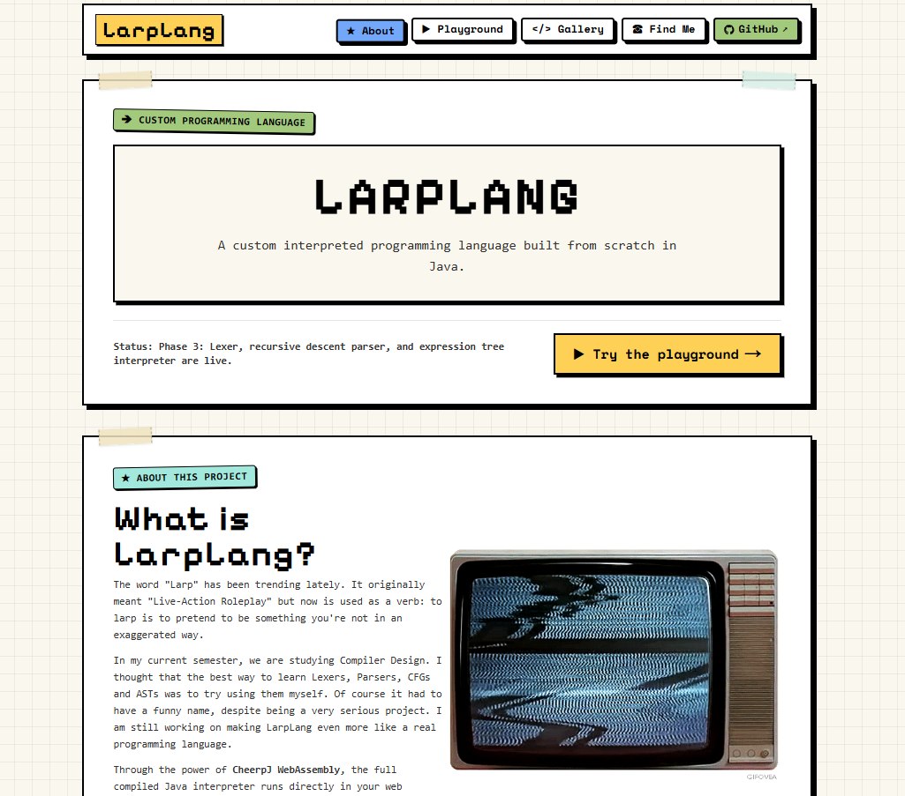

# LarpLang

[](https://openjdk.org/)
[](https://nextjs.org/)
[](https://cheerpj.com/)
[](#roadmap)
[](LICENSE)

> A custom interpreted programming language crafted from first principles in **Java 21**, complete with an interactive in-browser playground running on **WebAssembly**.

---

## Preview



---

## What is LarpLang?

The term *"larp"* originally stands for Live-Action Roleplay, but in internet slang, to larp is to pretend to be something you're not in an exaggerated, tongue-in-cheek way. 

LarpLang was born out of a college compiler design course. Instead of just studying Context-Free Grammars, recursive descent, and Abstract Syntax Trees on slides, the best way to understand them was to build a language engine from scratch. Despite the playful name, the codebase implements genuine compiler architecture principles: clean token scanning, precedence climbing, and robust tree-walking evaluation.

Even better: thanks to **CheerpJ 5.0**, the exact compiled Java engine runs client-side in the browser via WebAssembly without requiring a backend runtime.

---

## Language Syntax & Features

LarpLang swaps standard boilerplate for expressive, lighthearted keywords:

| Keyword | Purpose | Example |
| :--- | :--- | :--- |
| `yap` | Standard output (print line) | `yap "hello world"` |
| `t` / `f` | Boolean literals (`true` / `false`) | `yap (10 > 5) == t` |
| `ghost` | Sentinel null / nil value (evaluates falsy) | `yap !ghost` |
| `let` | Variable definition *(Phase 4)* | `let score = 100` |
| `if` / `else` | Conditional branching *(Phase 5)* | `if x > 0 { yap "positive" }` |
| `until` | Loop execution *(Phase 5)* | `until count == 0 { ... }` |
| `func` / `gimme` | Functions and return statements *(Phase 6)* | `func add(a, b) { gimme a + b }` |

### Sample Program

```larp
# Arithmetic and grouping precedence
yap 1 + 2 * 3
yap (1 + 2) * 3

# String concatenation with numeric coercion
yap "Score: " + (50 * 2)

# Comparisons & equality
yap 10 > 5
yap "larp" == "larp"

# Truthiness with booleans and ghost (null)
yap !ghost
yap !f
```

---

## Architecture Pipeline

LarpLang follows a traditional multi-pass interpreter architecture:

```
Source Code (.larp)
        │
        ▼
   [ Lexer.java ]        Scanner converting source characters into Token records with line numbers
        │
        ▼
   [ Parser.java ]       Recursive descent parser handling precedence and constructing AST nodes
        │
        ▼
[ Interpreter.java ]     Tree-walking evaluator executing statements and managing expressions
```

* **AST Representation (`Expr.java`, `Stmt.java`):** Sealed interfaces using Java pattern-matching records (`Binary`, `Unary`, `Literal`, `Grouping`, `Print`).
* **Runtime (`Larp.java`):** Entry point managing parsing pipelines, stream buffering, and exception propagation.

---

## Build Guide

### Prerequisites

* **JDK 21 or newer** (with `javac` and `jar` on your system `PATH`)
* **Node.js 18+** (for running the web playground locally)

---

### 1. Building the Java Engine

From the project root:

**Windows (using build script):**
```cmd
build.bat
```

**Linux / macOS (manual):**
```bash
mkdir -p out
javac --release 21 -d out src/larp/*.java
jar cf web/public/larp.jar -C out .
```

This compiles the class files to `out/` and packages the deployable archive into `web/public/larp.jar` for the web playground.

---

### 2. Running LarpLang via CLI

To run a script from the command line:

```bash
java -cp out larp.Larp test.larp
```

---

### 3. Running the Web Playground Locally

The web frontend is built with Next.js (App Router) and Tailwind CSS:

```bash
cd web
npm install
npm run dev
```

Open [http://localhost:3000](http://localhost:3000) to view the site, explore the gallery, or run code interactively in the WebAssembly playground.

---

## Project Structure

```
LarpLang/
├── src/
│   └── larp/
│       ├── Environment.java     # Symbol table & lexical scope (Phase 4)
│       ├── Expr.java            # Sealed interface for AST expression nodes
│       ├── Interpreter.java     # Tree-walking evaluator
│       ├── Larp.java            # Main engine entry point
│       ├── Lexer.java           # Token scanner
│       ├── Parser.java          # Recursive descent precedence parser
│       ├── Stmt.java            # Statement declarations (yap, blocks)
│       ├── Token.java           # Immutable token record
│       └── TokenType.java       # Keyword and operator enums
├── web/
│   ├── public/
│   │   ├── adr.jpeg             # Developer portrait
│   │   ├── larp.jar             # Compiled WebAssembly JAR target
│   │   ├── larplang.png         # Project showcase preview
│   │   └── retro-tv.gif         # Visual asset
│   ├── src/
│   │   ├── app/                 # Next.js App Router (About, Playground, Gallery, Contact)
│   │   ├── components/          # UI components (Navbar, Stickers, Icons)
│   │   └── data/content.js      # Central site content & runnable examples
│   └── package.json
├── build.bat                    # Windows Java build script
├── phases.md                    # Roadmap & compiler phase notes
├── test.larp                    # Sample LarpLang test file
└── README.md
```

---

## Roadmap

- [x] **Phase 1: Lexer** - Full token scanning, keyword mapping, line tracking
- [x] **Phase 2: Parser** - Precedence climbing with recursive descent, grouping
- [x] **Phase 3: Interpreter** - Tree-walking evaluator, truthiness logic, `yap` standard output
- [ ] **Phase 4: Environments & Variables** - Dynamic scoping with `let`
- [ ] **Phase 5: Control Flow** - Conditional blocks (`if`/`else`) and loops (`until`)
- [ ] **Phase 6: Functions & Closures** - First-class callables (`func`, `gimme`)
- [ ] **Phase 7: Diagnostics & VM** - Rich error recovery and bytecode compilation

---

## License

This project is open-source under the [MIT License](LICENSE).
